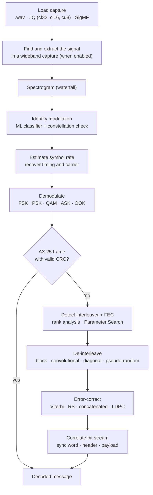
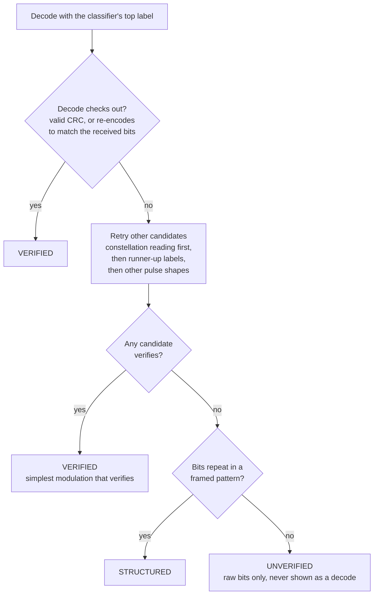
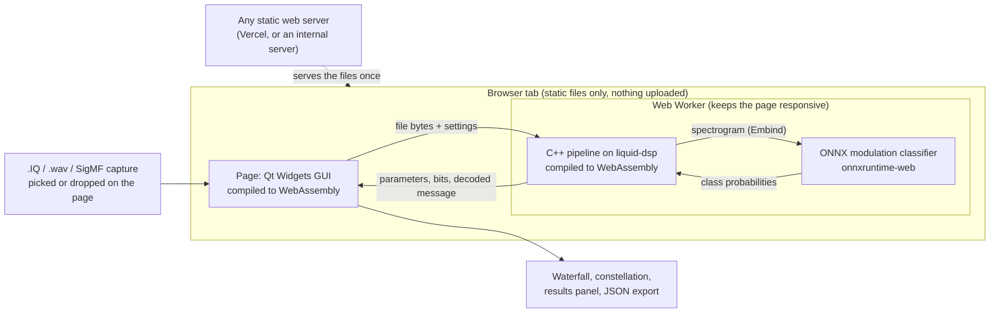

# PS 26147: Signal Analysis in the Browser

Automated analysis of `.IQ` and `.wav` signal captures, running entirely in the browser.

**Smart India Hackathon 2026**

| | |
| --- | --- |
| Problem statement | 26147: Automated model for analysis of .IQ and .wav files along with signal parameter extraction |
| Organisation | National Technical Research Organisation (NTRO) |
| Category / theme | Software / Space Technology |
| Live demo | https://dist-rho-plum-26.vercel.app (the app is at `/web/`) |

## The problem

Signals collected off the air (HF, VHF and UHF) are recorded as `.wav` or `.IQ` files. Analysing them is done
by hand today, and recordings from different sensors and places have different parameters, so details such
as modulation, FEC and interleaving are often unclear. The problem statement(PS) asks for a GUI tool that takes a capture,identifies its parameters, demodulates it, de-interleaves, error-corrects, and correlates the bit stream to
find header and payload.

## Our solution

Load a capture and the tool works out what it is, then decodes it. Every stage is shown: a waterfall, a
constellation plot and a results panel. It runs entirely client-side; no server, no Python at runtime, and
nothing leaves the user's machine.

### How a capture is analysed



The result is marked **verified** when a decode checks out (FEC re-encode agreement or a valid CRC),
**structured** when the bits repeat in a frame pattern, or **unverified** otherwise, so the tool never
presents a guess as a decode.



## Features

- **Parameter identification:** sampling rate from the WAV header or SigMF metadata (or entered by the
  user), strongest-signal frequency, blind symbol-rate estimation, and the modulation from an ML classifier
  plus a constellation check that reads the order (BPSK, QPSK, 8PSK, QAM16, QAM64) from the symbols
  themselves. If the classifier's top guess does not decode, its runner-up labels are tried.
- **Demodulation:** FSK, PSK (BPSK, QPSK, 8PSK and higher), QAM, ASK and OOK, with matched-filter timing and
  carrier recovery for real captures.
- **De-interleaving:** block, convolutional, diagonal and pseudo-random, detected automatically.
- **Error correction:** Viterbi (K=7, also punctured 2/3 and 3/4), Reed-Solomon (including RS(255,223)),
  concatenated, LDPC and an RS(255,223) + Viterbi chain, with soft-decision decoding.
- **Bit stream correlation:** header and payload boundaries, frame period, a frame raster (sync word,
  counter and payload columns) and blind rank analysis.
- **Real-signal support:** blind wideband channel finding for signals that are not at baseband, and a choice
  of transmit pulse shape.
- **Satellite link layers:** NRZI, G3RUH scrambling, HDLC framing and AX.25 with CRC-16, so a beacon decodes
  to readable text. Checked against ten real over-the-air CPSat beacon recordings: all ten decode to their
  published frames.
- **Large captures:** analysis runs in a Web Worker so the page stays responsive, and big files are read in
  128 MiB windows (tested on a 2.25 GiB file).
- **Results:** a waterfall, a constellation plot and a results panel, with a JSON export of the analysis.

## Architecture



| Layer | Technology |
| --- | --- |
| DSP and FEC engine | C++ with liquid-dsp, compiled to WebAssembly with Emscripten |
| GUI | Qt Widgets compiled to WebAssembly (plots drawn with `QPainter`) |
| Modulation classifier | PyTorch CNN exported to ONNX, run in the browser with onnxruntime-web |
| C++ and JavaScript link | Embind |
| Hosting | Static files; no special headers or server needed |

| Directory | Contents |
| --- | --- |
| [core/](core) | DSP and FEC engine |
| [app/](app) | Pipeline orchestration and the Qt Widgets GUI |
| [bridge/](bridge) | Embind bridge between C++ and the JS model |
| [ml/](ml) | Model definition and ONNX export (Python, development only) |
| [web/](web) | Page shell and the JS that runs the model |
| [tests/](tests) | Test suite and fixtures |
| [scripts/](scripts) | Toolchain setup, builds, serving, verification |

## Run it locally

```bash
scripts/setup-toolchain.sh        # once: Emscripten 3.1.56 + Qt 6.8.3 for WebAssembly
scripts/build-liquid-wasm.sh      # once: liquid-dsp for WASM
npm install                       # once: onnxruntime-web
scripts/build-wasm.sh             # builds the app into build-wasm/dist
scripts/serve.sh                  # open http://localhost:8080/ and drop a capture on the page
```

`build-wasm/dist` is the whole product and works on any static host. See [BUILDING.md](BUILDING.md).
Tests: `ctest --test-dir build` (native) and `ctest --test-dir build-wasm` (WebAssembly, including real
Chrome). [tests/COVERAGE.md](tests/COVERAGE.md) lists what is covered.

## License

[GPLv3](LICENSE). Qt is statically linked into the WASM build, which requires a GPL-compatible license.
